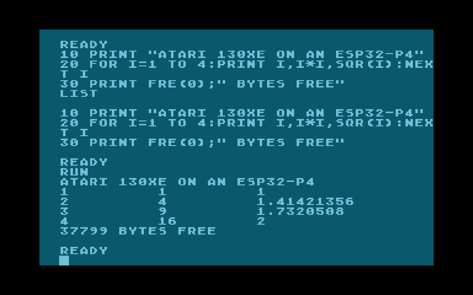
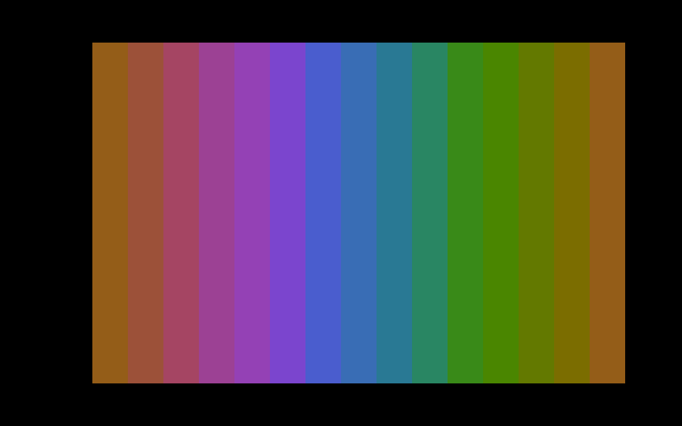
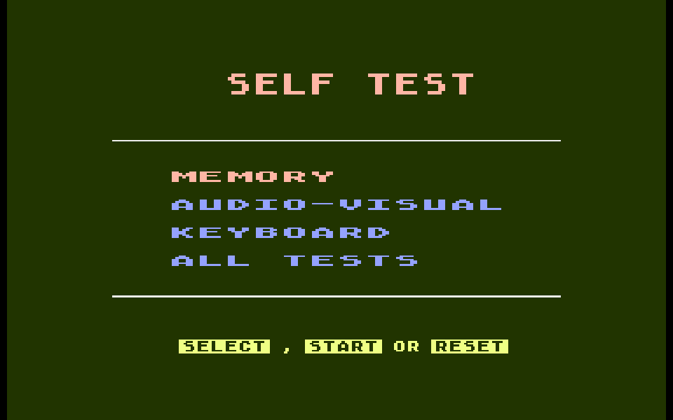
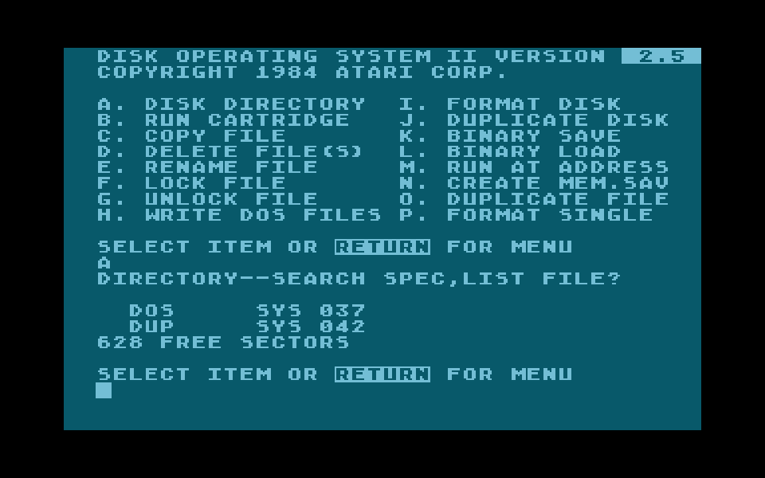
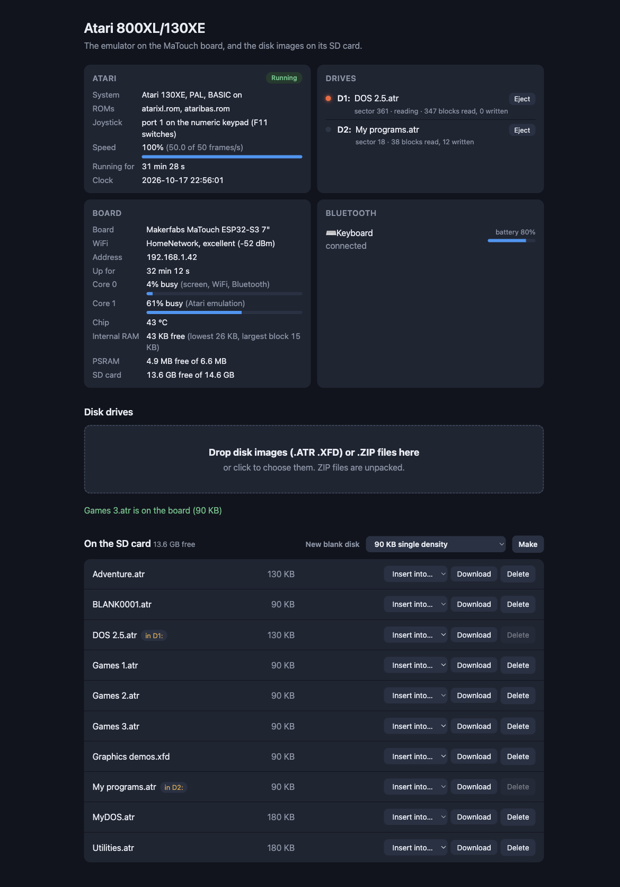
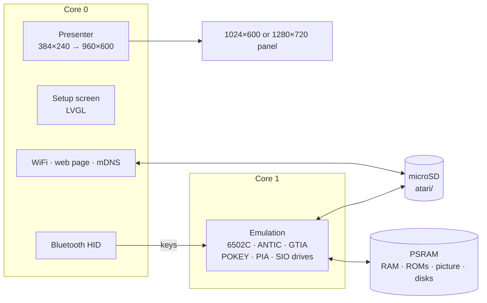

<h1 align="center">esp32xl</h1>

<p align="center">
  <b>An Atari 800XL or 130XE on a 7-inch ESP32-S3 touch-screen board or an M5Stack Tab5.</b><br>
  6502C with ANTIC's DMA to the cycle, GTIA with all its modes, POKEY sound, disk drives D1: and D2: with ATR and XFD images, Bluetooth keyboard.
</p>

<p align="center">
  
  
  
  
  
  
</p>

<p align="center">
  <b>Work in progress:</b> not everything has been tested, and games and demos may or may not
  work satisfactorily.
</p>

<p align="center">
  
  
  <br>
  
  
  <br>
  <sub>Atari BASIC on the 130XE; GTIA's 16 hues in GRAPHICS 11; the Self Test (BYE from
  BASIC); DOS 2.5 listing its disk. As on the MaTouch's panel, border included.</sub>
</p>

esp32xl turns the Makerfabs MaTouch ESP32-S3 Parallel TFT with Touch 7", or an
M5Stack Tab5, into an Atari 800XL or 130XE. The picture, overscan border
included, fills the panel's height; a Bluetooth keyboard works the Atari, and
disk images come from the microSD card. A setup screen on the touch panel,
and a web page on your network, handle everything else.

It's the sibling of [esp32ste](https://github.com/rlucencic/esp32ste) (Atari
STE), [esp32mac](https://github.com/rlucencic/esp32mac) (Macintosh Plus, SE,
Classic), [esp32mac2](https://github.com/rlucencic/esp32mac2) (Macintosh LC
and II, Tab5 only), [esp32mac3](https://github.com/rlucencic/esp32mac3)
(Macintosh LC II and LC III, Tab5 only),
[esp32cpc](https://github.com/rlucencic/esp32cpc) (Amstrad CPC),
[esp32zx](https://github.com/rlucencic/esp32zx) (ZX Spectrum),
[esp32cbm](https://github.com/rlucencic/esp32cbm) (Commodore 64 and 128),
[esp32msx](https://github.com/rlucencic/esp32msx) (MSX1 and MSX2),
[esp32gs](https://github.com/rlucencic/esp32gs) (Apple IIGS) and
[esp32coco](https://github.com/rlucencic/esp32coco) (Tandy Color Computer 2
and 3); all are built on the shared runtime
[esp32emu](https://github.com/rlucencic/esp32emu), which also holds the 6502
core this one shares with the Commodores.

## Features

**The machines**
- **Atari 800XL** (64 KB) and **130XE** (128 KB: four more 16 KB banks at
  `$4000`, for the CPU and ANTIC separately), **PAL or NTSC**, **Atari
  BASIC** on or off, chosen on the setup screen
- **6502C**: every bus cycle as the real CPU does it, on the shared 6502 core
- **ANTIC**: its DMA takes the CPU's cycles where the real one does (display
  list, screen data, characters, players and missiles, memory refresh), and
  WSYNC holds the CPU to the cycle; all text and graphics modes (2 to F),
  horizontal and vertical fine scrolling, narrow, normal and wide
  playfields, display list and vertical blank interrupts
- **GTIA**: players and missiles in all sizes, priority as GTIA's own logic
  (the fifth player, multicolour players), collisions, the GTIA modes 9, 10
  and 11 (16 shades, 9 colours, 16 hues), colour changes in the middle of a
  line timed to the colour clock, PAL and NTSC palettes
- **POKEY**: four sound channels, 8 and 16-bit timers at 64 kHz, 15 kHz or
  1.79 MHz, the 4, 5, 9 and 17-bit noise generators, high-pass filters,
  volume-only mode for samples, timer interrupts, the keyboard, RANDOM, the
  console speaker
- **PIA**: the XL's memory control (OS ROM, BASIC, Self Test, the 130XE's
  banks) and the joystick ports

**Disk drives**
- **D1: and D2:** on the SIO bus, like a 1050 that also does double density:
  status, read, write, format (single and enhanced density) and the PERCOM
  block that DOSes ask for
- **`.ATR`** (128 and 256-byte sectors, whichever way the first three sectors
  are stored) and **`.XFD`** images; writes go back into the image file
- **Fast**: the OS's disk calls are served straight from its device control
  block. Programs that work POKEY's serial port themselves still find the
  whole bus, byte by byte at 19,200 baud
- **New blank disks**: 90 KB single, 130 KB enhanced (1050) or 180 KB double
  density, ready for DOS to format

**Around it**
- **Setup screen** before the Atari starts, and any time while it runs (hold
  the top-right corner for 2 seconds): WiFi, Bluetooth pairing, the model,
  TV standard, BASIC, the drives, reset
- **Bluetooth keyboard** (BLE HID): letters where a PC has them, symbols by
  the character on the key; HELP, START, SELECT, OPTION, RESET and BREAK on
  F1 to F7; the joystick on the numeric keypad
- **Web page** at `http://atari-xl.local`: drop disk images or `.ZIP` files
  onto it (with a progress bar), put them into drives, eject, make blank
  disks, and watch the machine, drives, board and Bluetooth devices live
- **Sound** on the board's speaker (on the Tab5 by default, on the MaTouch
  optional, `menuconfig`)

<p align="center">
  
</p>

## Hardware

| | Makerfabs MaTouch ESP32-S3 7" | M5Stack Tab5 |
|---|---|---|
| Chip | ESP32-S3-WROOM-1-N16R8: 16 MB flash, 8 MB octal PSRAM | ESP32-P4 (RISC-V, 360 MHz): 16 MB flash, 32 MB PSRAM; an ESP32-C6 for WiFi and Bluetooth |
| Screen | 7" 1024×600 RGB, GT911 capacitive touch | 5" 1280×720 MIPI-DSI, capacitive touch, held landscape |
| Storage | microSD card (FAT32 or exFAT) | microSD card (FAT32 or exFAT) |
| Input | any BLE keyboard | any BLE keyboard, or the Tab5 Keyboard |
| Sound | a speaker on the MAX98357A output (optional, `menuconfig`) | the built-in speaker (ES8388) |

The picture is 384×240: the normal 320×192 playfield with the overscan
border around it (a wide playfield fills it), 192 colour clocks by 240 lines.
On the MaTouch it's 2.5 times as big, 960×600; on the Tab5 3 times,
1152×720.

## Getting started

### 1. What you need

- [ESP-IDF](https://github.com/espressif/esp-idf) v5.5 (developed with v5.5.4)
- [esp32emu](https://github.com/rlucencic/esp32emu), checked out next to this project (`../esp32emu`)
- The Atari ROM images in `roms/` (see [roms/README.md](roms/README.md)): the XL/XE OS and, if you like, Atari BASIC
- A microSD card, FAT32 or exFAT

### 2. Build and flash

```sh
git clone https://github.com/rlucencic/esp32emu.git     # the shared runtime, next to it
git clone https://github.com/rlucencic/esp32xl.git && cd esp32xl
idf.py build
idf.py -p /dev/cu.usbmodem… flash      # app and the ROM images

# or for the M5Stack Tab5 (its own build folder and settings):
idf.py -B build-tab5 -DIDF_TARGET=esp32p4 -DSDKCONFIG=build-tab5/sdkconfig build
idf.py -B build-tab5 -DIDF_TARGET=esp32p4 -DSDKCONFIG=build-tab5/sdkconfig -p /dev/cu.usbmodem… flash
```

Later updates only need `idf.py -p … app-flash`. Instead of flashing the
ROMs, you can also copy them into a `roms` folder on the SD card.

### 3. First start

1. The board starts on the **setup screen**. Tap **WiFi** to join your
   network: the web page becomes reachable.
2. Tap **Bluetooth** to pair a keyboard.
3. Choose the **model**, the **TV** standard and **BASIC**, then tap **Start**.
4. Open `http://atari-xl.local`, drop a disk image onto the page, then
   **Insert into… → D1:**, and **Reset** on the setup screen: the Atari
   boots from it.

<p align="center">
  
</p>

## Using it

| To | Do |
|---|---|
| Get back to the setup screen | Hold the top-right corner of the screen for 2 s |
| Change the model, TV or BASIC | On the setup screen; **Restart** applies it |
| Boot a disk | Insert it into **D1:** (setup screen's Disks page, or the web page), then **Reset** on the setup screen: a cold start, as switching the Atari off and on. Most games want BASIC off |
| Use DOS 2.5 | Boot its disk; **A** and Return lists the directory, **L** loads a binary file, **B** goes to BASIC |
| Load a BASIC program | `RUN "D:NAME.BAS"` (or `LOAD`, `ENTER` for listings) |
| Make a new disk | **New** next to D1: or D2: on the drives page, or on the web page; then format it in DOS (DOS 2.5: **I**) |
| Self Test | `BYE` in BASIC, or start with BASIC off and no disk |
| Copy files from a computer | Drop them onto the web page (ZIP files are unpacked), or `curl -T game.atr http://atari-xl.local/disks/` |

Disk images live in the `atari` folder on the SD card. The inserted ones are
remembered across restarts. Colours cycling after about ten minutes without
a key press are the Atari's own attract mode (a screen saver): any key ends
it.

**Keyboard**: letters by position; digits and symbols by the character they
give on a US keyboard, with SHIFT as the Atari needs it (Shift+' is ", which
is Shift+2 on the Atari). Return, Esc, Tab, Backspace (DELETE BACK S), Caps
Lock (CAPS) and Ctrl as themselves; Delete is Ctrl+DELETE, Insert
Ctrl+INSERT, Home CLEAR, `` ` `` and End the inverse (Atari) key; the cursor
keys are Ctrl with `-` `=` `+` `*`. F1 HELP, F2 START, F3 SELECT, F4 OPTION,
F5 RESET, F7 or Pause BREAK.

**Joystick**: the numeric keypad (8 4 6 2 and the diagonals, 0 or 5 fire) in
port 1; F11 switches it to port 2. F12 makes the cursor keys the joystick as
well, with Alt as fire.

## Configuration

`idf.py menuconfig` → **Emulator board**:

| Option | Default | |
|---|---|---|
| WiFi, setup screen | on | Time zone for the clock (POSIX TZ) |
| Start by itself | off | Countdown on the setup screen |
| Web page, network name | on, `atari-xl` | `http://<name>.local` |
| BLE keyboard and mouse | on | |
| Sound on the speaker | off (Tab5: on) | Volume; moves the MaTouch's console to the UART port |

## How it works



- **`components/atari_xl`**: the 800XL and 130XE, platform independent. It
  also builds on a desktop (`components/atari_xl/host`) for testing with
  scripted typing, keys and joystick, disks, screenshots, sound recording and
  CPU traces.
- **`main`**: the Atari on the board: memory, ROMs, settings, keyboard map,
  drives and status.
- **[esp32emu](https://github.com/rlucencic/esp32emu)**: the board runtime
  and the 6502 core.

A PAL frame is 312 lines of 114 cycles (1.77 MHz; NTSC 262 lines at 1.79
MHz). The CPU runs a line at a time. As each line begins, ANTIC works out
which of its cycles its DMA takes (each combination of modes, widths and
scrolling once, then from a table), and the 6502 core steps over those
cycles by itself. GTIA draws the line as the beam passes it, catching up
before every register write so that mid-line colour changes land where they
do on the real chip; a line that comes out the same as last frame isn't
drawn again. Everything follows Avery Lee's
[Altirra Hardware Reference Manual](https://www.virtualdub.org/altirra.html).

## Development

```sh
make -C components/atari_xl/host                                   # desktop build of the core
XL_BASIC=roms/ataribas.rom components/atari_xl/host/build/xl_host roms/atarixl.rom 300 out.ppm
XL_DISK1=dos25.atr components/atari_xl/host/build/xl_host roms/atarixl.rom 400 dos.ppm
make -C ../esp32emu/components/m6502/test                          # the 6502 tests

python ../esp32emu/tools/emu_console.py /dev/cu.usbmodem… screenshot screen.png    # the Atari's screen
python ../esp32emu/tools/emu_console.py /dev/cu.usbmodem… send 'T PRINT 1\n'      # type on the Atari
python ../esp32emu/tools/emu_console.py /dev/cu.usbmodem… profile build/esp32xl.elf  # where the time goes
curl http://atari-xl.local/api/status                                             # live status as JSON
```

`CLAUDE.md` has the details: architecture, timing, the drives, debugging
options and the lessons learned along the way.

## Limitations

- The M5Stack Tab5 port is new: the Atari runs there at full speed with core 1
  less than half busy, but sound, touch, Bluetooth and the Tab5 Keyboard have
  not been tried on it by hand yet.
- Tested so far with BASIC, the Self Test, Atari DOS 2.5 (formatting and
  copying too), MyDOS 4.50 in double density, the 130XE's banks and a few
  graphics demos; **games haven't been tried yet**.
- No cartridges, `.XEX` or `.CAS` files, no copy-protected disk images
  (`.ATX`, `.PRO`); no cassette, printer or 850 interface.
- ANTIC reads its registers as a line begins: a change in the middle of a
  line (a new character set, scrolling) shows from the next line. NTSC
  colour artefacts in high resolution aren't shown.
- Disks are faster than a real 1050: the drive answers at once, with no
  waiting for the disk to turn.

## Credits

- Avery Lee's [Altirra Hardware Reference Manual](https://www.virtualdub.org/altirra.html):
  the reference for ANTIC's DMA timing, GTIA's priority logic, POKEY, the SIO
  protocol and the disk drives
- Klaus Dormann's 6502 functional tests
- [LVGL](https://lvgl.io) for the setup screen
- [ESP-IDF](https://github.com/espressif/esp-idf) and NimBLE

## Licence

[MIT](LICENSE). LVGL (MIT) and ESP-IDF (Apache 2.0) are fetched at build time
and keep their own licences.

Atari, 800XL and 130XE are trademarks of their owners. The ROM images are not
part of this repository.
